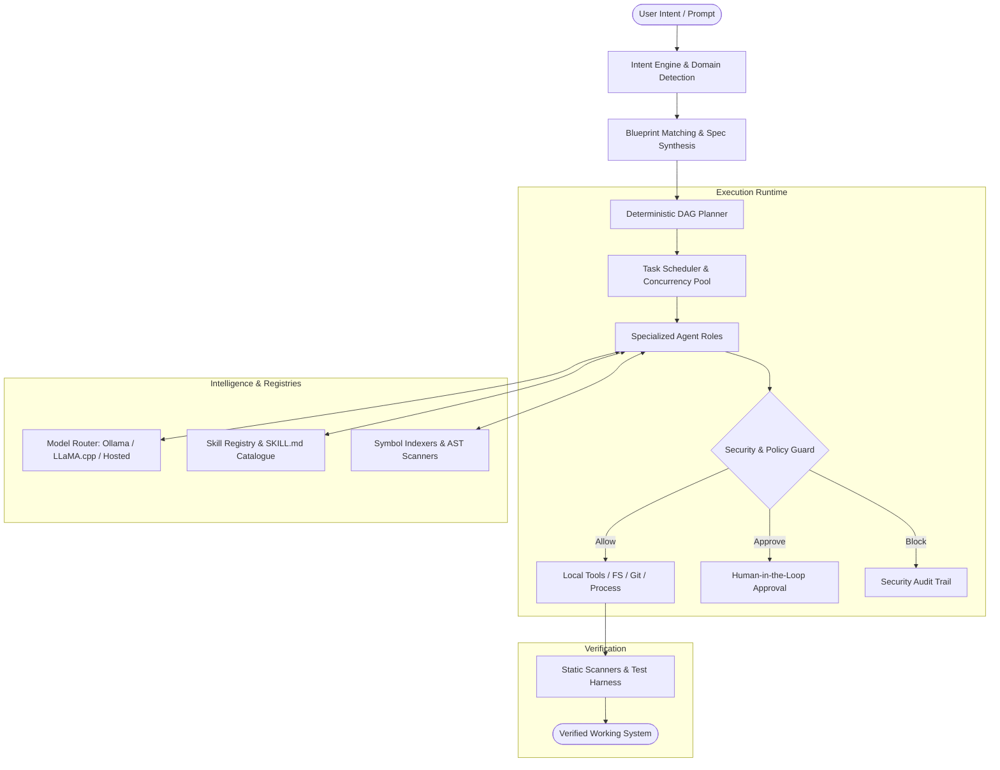

# Veylora OS 🌐⚡

> **From Intent to Working Systems.**  
> A local orchestration runtime, deterministic DAG planner, and multi-agent system that turns high-level software intent into verified, secure, and production-ready codebases.

[](package.json)
[](pyproject.toml)
[](apps/frontend)
[](apps/frontend)
[](backend)
[](pyproject.toml)

---

## 🌟 Overview

**Veylora OS** bridges the gap between natural language prompts and engineered software. Instead of relying on monolithic LLM generation, Veylora decomposes goals into a formal **Intent Specification**, generates a **Directed Acyclic Graph (DAG)** of granular tasks, enforces **Zero-Trust Security Policies**, and coordinates specialized autonomous agent roles to scaffold, code, verify, and test applications locally.



---

## 🚀 Key Highlights

- **🧠 Deterministic DAG Planning**: Automatically detects application domains (e.g. *Supply Chain, Design Editors, Web Applications, Reverse Engineering*) and produces validated, cyclic-free dependency graphs with guaranteed verification stages.
- **🛡️ Zero-Trust Security & Human-in-the-Loop**: Every agent action is sandboxed against fine-grained permission grants (`fs.read`, `fs.write`, `process.exec`, `net.egress`, `dependency.install`, `rea.inspect`). Destructive operations require interactive approvals.
- **👥 Specialized Multi-Agent Roles**: Discrete agent personas (`planner`, `architect`, `frontend_engineer`, `backend_engineer`, `security_reviewer`, `test_engineer`, `repo_discovery`, `skill_discovery`, `devops`).
- **🧩 Skills & Capability Integration**: Fully compliant parser for the `SKILL.md` format, supporting automated local directory scanning, untrusted skill sandboxing, and one-click GitHub archive imports (`awesome-llm-skills`).
- **🔌 Local-First Model Engine**: Zero cloud lock-in. Powered natively by local Ollama instances (`llama3`, `deepseek-r1`, `qwen2.5-coder`), local `llama.cpp`, or fallback OpenAI-compatible APIs.
- **🎨 Glassmorphic React 19 Frontend**: Real-time observability dashboard with live event streaming, Agent Ops metrics (CPU/RAM/concurrency), project workspaces, model management, and code explorer.

---

## 🏗️ Architecture

```
veylora-os/
├── apps/
│   ├── frontend/             # React 19 + Vite + Tailwind CSS dashboard
│   └── desktop/              # Electron desktop application shell
├── backend/
│   ├── agents/               # Role definitions, permission matrices & profiles
│   ├── api/                  # FastAPI REST endpoints & WebSocket event streams
│   ├── blueprints/           # Pre-packaged application architectures & templates
│   ├── execution/            # Local tool runners, shell wrappers, sandbox isolation
│   ├── intent/               # Intent parsing, entity extraction & domain classification
│   ├── models/               # Model routing, local Ollama client & prompt templates
│   ├── orchestration/        # DAG validation, topological sorting & task scheduler
│   ├── persistence/          # SQLite database layer, migrations & project storage
│   ├── planning/             # Task graph builders & dependency resolvers
│   ├── registries/           # Skill registry, capabilities & role mapping
│   └── security/             # Policy engine, static code scanning & approval gate
├── integrations/
│   └── skills/               # SKILL.md parser, directory scanner & GitHub catalogue
├── packages/
│   └── contracts/            # Shared TypeScript API schemas, enums & interfaces
├── scripts/                  # End-to-end acceptance run harness
└── tests/                    # Unit, integration, and security test suites
```

---

## 🔒 Security & Agent Roles Matrix

Each agent in Veylora OS operates under a strictly scoped permission profile:

| Agent Role | Model Class | Context Budget | Filesystem | Git / Process | Network Egress | External Inspection |
| :--- | :--- | :--- | :--- | :--- | :--- | :--- |
| **Planner** | Planning | 4,096 tokens | Read Only | ❌ Disabled | ❌ Disabled | ❌ Disabled |
| **Architect** | Planning | 4,096 tokens | Read / Write | ❌ Disabled | ❌ Disabled | ❌ Disabled |
| **Frontend Engineer** | Coding (Complex) | 8,192 tokens | Workspace Only | Process Exec | ❌ Disabled | ❌ Disabled |
| **Backend Engineer** | Coding (Complex) | 8,192 tokens | Workspace Only | Process Exec | ❌ Disabled | ❌ Disabled |
| **Repo Discovery** | Extraction | 4,096 tokens | Read Only | ❌ Disabled | Allowlist Only | Approval Required |
| **Security Reviewer** | Reasoning | 8,192 tokens | Read Only | ❌ Disabled | ❌ Disabled | ❌ Disabled |
| **DevOps** | Automation | 4,096 tokens | Workspace Only | Process Exec | Allowlist Only | ❌ Disabled |

---

## ⚡ Quickstart

### Prerequisites

- **Python**: `>= 3.11`
- **Node.js**: `>= 20`
- **Ollama** (optional for local models): running on `http://127.0.0.1:11434`
- **Git**

---

### 1. Installation

Clone and install dependencies:

```bash
# Clone the repository
git clone https://github.com/dcsgod/veylora-os.git
cd veylora-os

# Install Python virtual environment & dependencies
python -m venv .venv
source .venv/bin/activate    # On Windows: .venv\Scripts\activate
pip install -e ".[dev,browser]"

# Install Node workspace dependencies
npm install
```

---

### 2. Configure Environment

Create an environment file for the frontend:

```bash
# apps/frontend/.env
VITE_VEYLORA_API=http://127.0.0.1:47821
VITE_VEYLORA_TOKEN=veylora-dev-token
```

---

### 3. Run Veylora OS

#### Start the Backend
```bash
# Windows PowerShell
$env:VEYLORA_SESSION_TOKEN = "veylora-dev-token"
$env:VEYLORA_ALLOWED_ORIGINS = "http://localhost:5174,http://127.0.0.1:5174"
python -m backend.main

# Linux / macOS
export VEYLORA_SESSION_TOKEN="veylora-dev-token"
export VEYLORA_ALLOWED_ORIGINS="http://localhost:5174,http://127.0.0.1:5174"
python -m backend.main
```
*The backend API initializes on `http://127.0.0.1:47821`.*

#### Start the Frontend
In a new terminal:
```bash
npm run dev:frontend
```
*The dashboard is live at `http://127.0.0.1:5174`.*

---

## 🛠️ Testing & Verification

Run the complete test suite:

```bash
# Run backend unit tests
pytest tests/unit -v

# Run acceptance e2e pipeline test
python scripts/e2e_run.py "Build a habit tracker with streaks and reminders" --auto-approve

# Run frontend tests
npm run test:frontend
```

---

## 📦 Blueprints

Veylora comes with built-in scaffolds configured with automated verification:

- **`supply-chain`**: Inventory tracking, replenishment logic, demand forecasting, and simulation components.
- **`design-editor`**: Canvas-based layered design tools with SVG/PNG rasterization pipelines.
- **`web-app`**: Full-stack reactive applications with modular persistence and responsive UI.

---

## 🤝 Contributing

1. Fork the Project
2. Create your Feature Branch (`git checkout -b feature/AmazingFeature`)
3. Commit your Changes (`git commit -m 'Add some AmazingFeature'`)
4. Push to the Branch (`git push origin feature/AmazingFeature`)
5. Open a Pull Request

---

## 📄 License

Proprietary — all rights reserved until an open-source license is officially selected.
